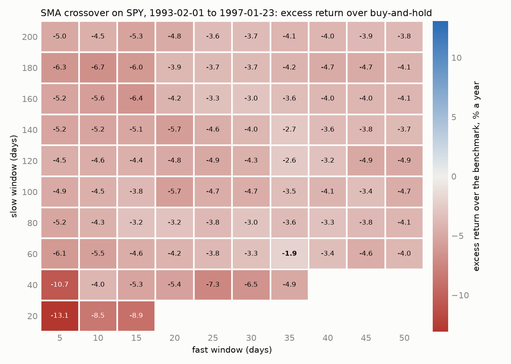

# Baseline: SMA 50/200 crossover on SPY

Data: SPY daily bars from yahoo, adjusted for splits and dividends, 1993-01-29 to 2025-11-13 (8256 bars, fingerprint `d5889bd1bcb8bc20`). Costs: 0 bps fee plus 2 bps slippage per position change. Tax estimate: 22% on gains held a year or less, 15% on longer holds. Bars from 2025-11-14 on are the locked holdout and were not read.

Window: the development window, 1993-02-01 to 1997-01-23 (1007 bars). Walk-forward data after it is single use and was left alone.

| Metric | SMA 50/200 | Buy-and-hold SPY |
|---|---:|---:|
| Total return | 70.44% | 94.29% |
| CAGR (return per year) | 14.28% | 18.08% |
| Sharpe ratio | 1.48 | 1.63 |
| Max drawdown | -10.75% | -8.54% |
| Profit factor | 1.34 | 1.31 |
| Trades | 2 | 1 |
| Exposure (share of days invested) | 71.60% | 100.00% |
| After-tax total return | 59.84% | 80.11% |
| After-tax CAGR | 12.45% | 15.86% |

- Excess CAGR over SPY after costs: **-3.81%** a year
- Sharpe difference: -0.15
- Excess CAGR over SPY after costs and tax: **-3.41%** a year
- Beats buy-and-hold SPY after costs and tax: **NO**

## Parameter sweep (90 parameter sets)

- Best cell: fast 35, slow 60, excess CAGR -1.94% a year
- Average of its 7 neighbours: -4.00% a year
- Shape: **spike** (spike score 1.30; above 1 means the best cell stands alone)
- Share of the grid that beat SPY: 0%

Tests counted so far: 1 idea(s), 90 parameter sets.
